# BIOHAZARD 5 SAVE EDITOR

[](https://github.com/lux-insider/biohazard5-save-editor/releases/latest)
[](https://github.com/lux-insider/biohazard5-save-editor/actions/workflows/testes.yml)
[](LICENSE)


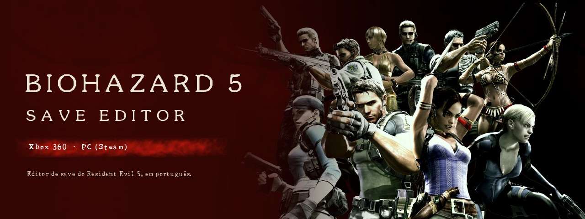

Editor de save do **Resident Evil 5** para **Xbox 360** e **PC (Steam)**, em
português, com o visual do próprio jogo. Programa nativo para Windows e
Linux, escrito em Rust com interface em Slint: não usa navegador, WebView
nem instalador.

---

## Sumário

- [Funcionalidades](#funcionalidades)
- [Capturas de tela](#capturas-de-tela)
- [Download](#download)
- [Como usar](#como-usar)
- [Assinatura do save do Xbox 360](#assinatura-do-save-do-xbox-360)
- [Segurança e integridade](#segurança-e-integridade)
- [Compilação](#compilação)
- [Estrutura do projeto](#estrutura-do-projeto)
- [Testes e validação](#testes-e-validação)
- [Documentação](#documentação)
- [Contribuir](#contribuir)
- [Licença](#licença)

---

## Funcionalidades

| Recurso | Xbox 360 | PC (Steam) |
|---|:---:|:---:|
| Gold / Money e Exchange Points | ✓ | ✓ |
| Data do save | ✓ | ✓ |
| Roupas, filtros de tela, munição infinita, arquivos e Figuras | ✓ | ✓ |
| Slots do Chris e da Sheva | ✓ | ✓ |
| Inventário (baú) | ✓ 84 espaços | ✓ 74 espaços |
| Perfil (XUID), Device ID e gamertag | ✓ | — |
| Nome do save no dashboard | ✓ | — |
| Steam ID | — | ✓ |
| Assinatura do pacote | ✓ automática | não se aplica |

**Abas do editor**

| Aba | O que oferece |
|---|---|
| **Save** | Miniatura e nome do save, Gold, Exchange Points, data, perfil com gamertag, pasta correta no pendrive e o estado da integridade (checksum, hashes e assinatura). |
| **Desbloqueios** | Roupas do Chris e da Sheva, filtros de tela, munição infinita das 19 armas (com o ícone de cada uma), os 12 arquivos da Biblioteca e as 45 Figuras. |
| **Personagens** | Os 9 slots do Chris e da Sheva, oferecendo só o que o jogo aceita em cada slot. |
| **Inventário** | O baú em grade de ícones, como no jogo, com filtro por categoria. |
| **Itens Extras** | Consulta aos registros da tabela de itens que não vão para o save (armas de inimigos, objetos de fase, itens das DLCs), com ficha de cada um. |
| **História** | Os 12 arquivos da Biblioteca com as ilustrações do jogo, os 26 documentos das fases e os 9 das DLCs, traduzidos para o português. |

O catálogo cobre os **407 registros de item** do jogo, com nome oficial,
descrição e os **174 ícones originais** do RE5 e das DLCs.

> **Munição infinita:** depois de desbloquear as armas na aba Desbloqueios,
> ative o modo no jogo antes de começar a campanha: no menu principal, entre em
> **Ajustes especiais** → **Munição infinita** e deixe
> **Modo munição infinita** em **SIM**.
>
> | 1. Ajustes especiais | 2. Munição infinita | 3. Modo munição infinita: SIM |
> |---|---|---|
> | 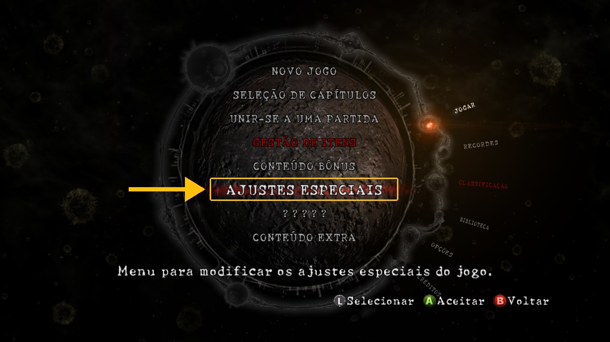 | 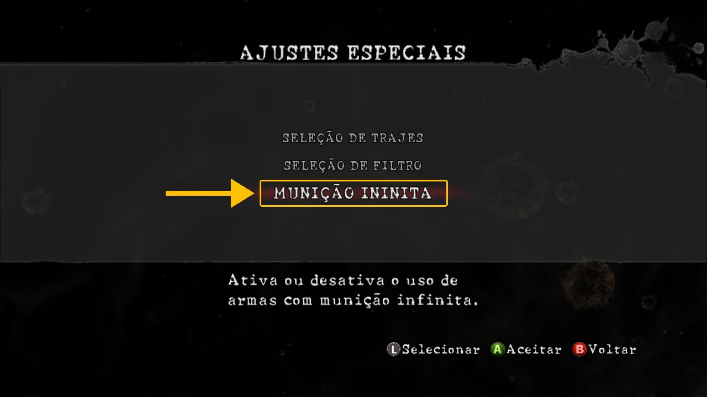 | 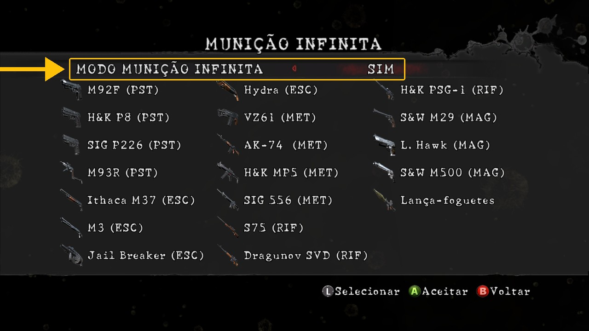 |

---

## Capturas de tela

| | |
|---|---|
| 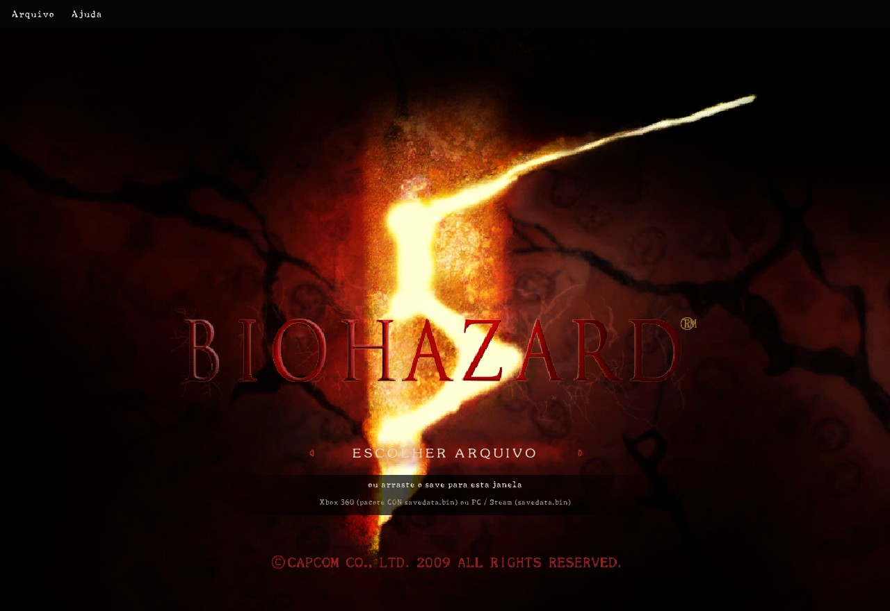 | 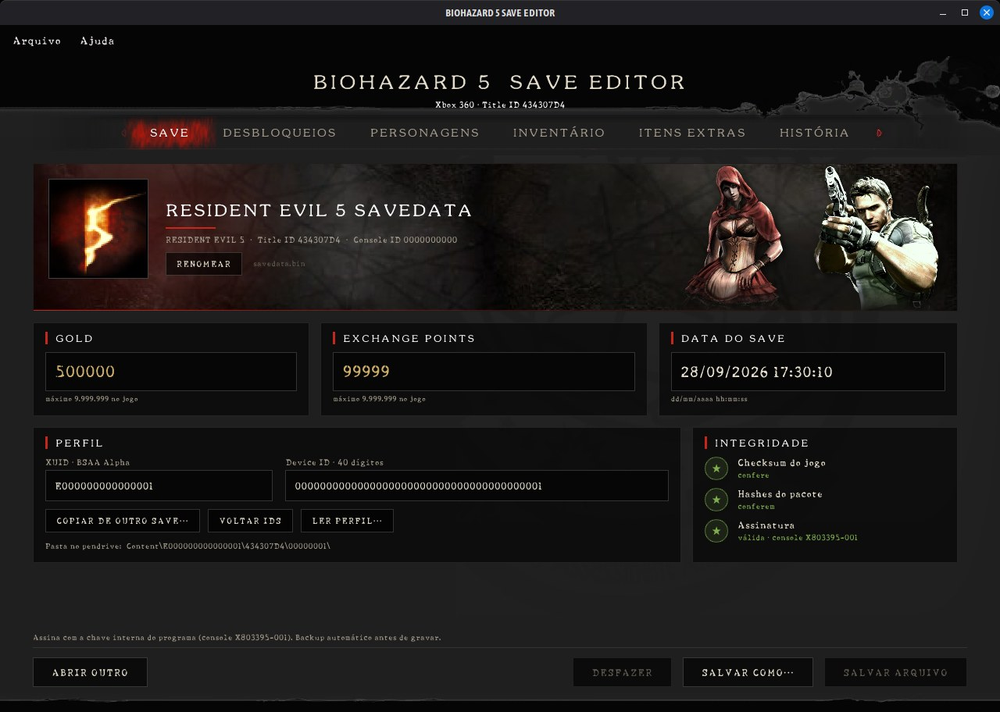 |
| 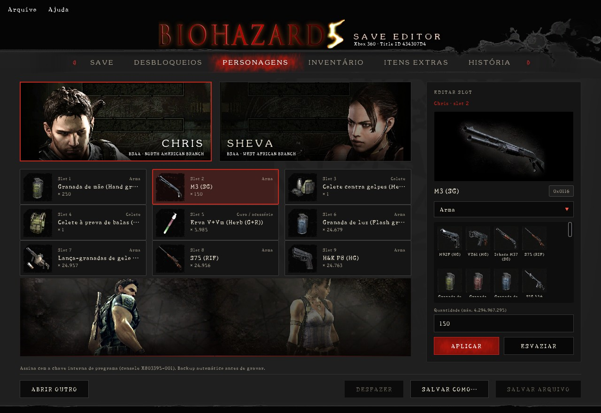 | 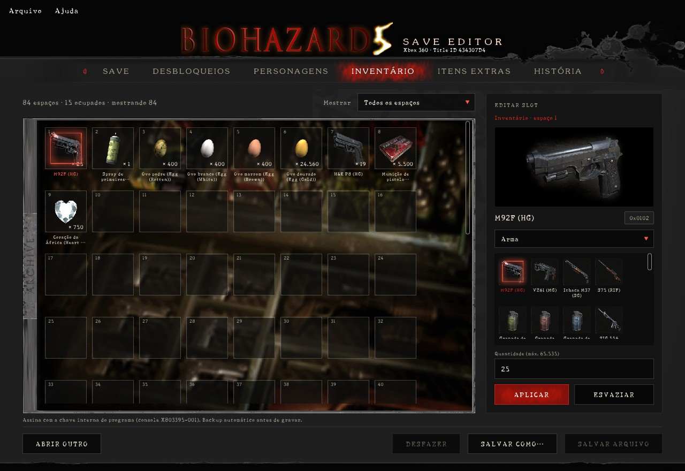 |
| 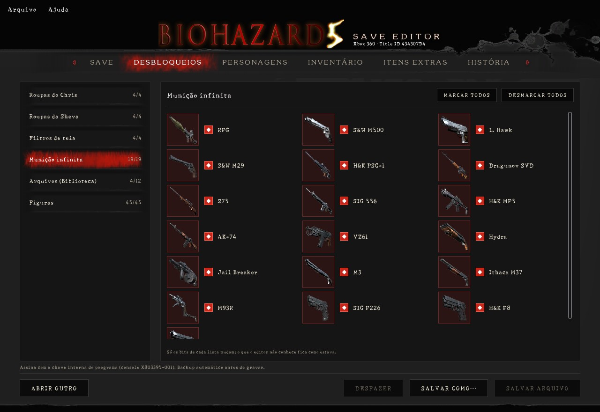 | 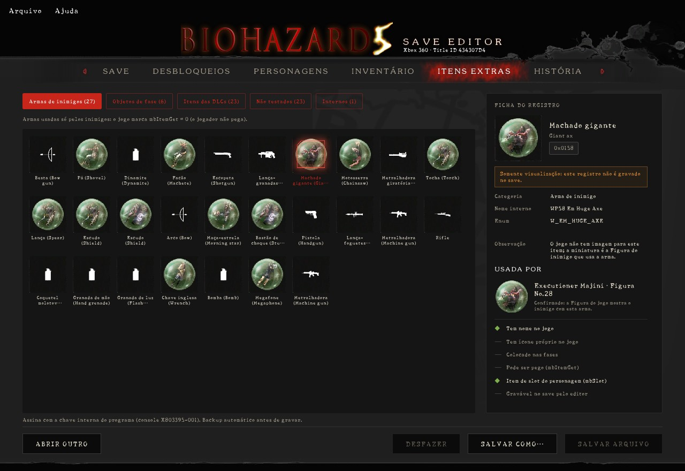 |
| 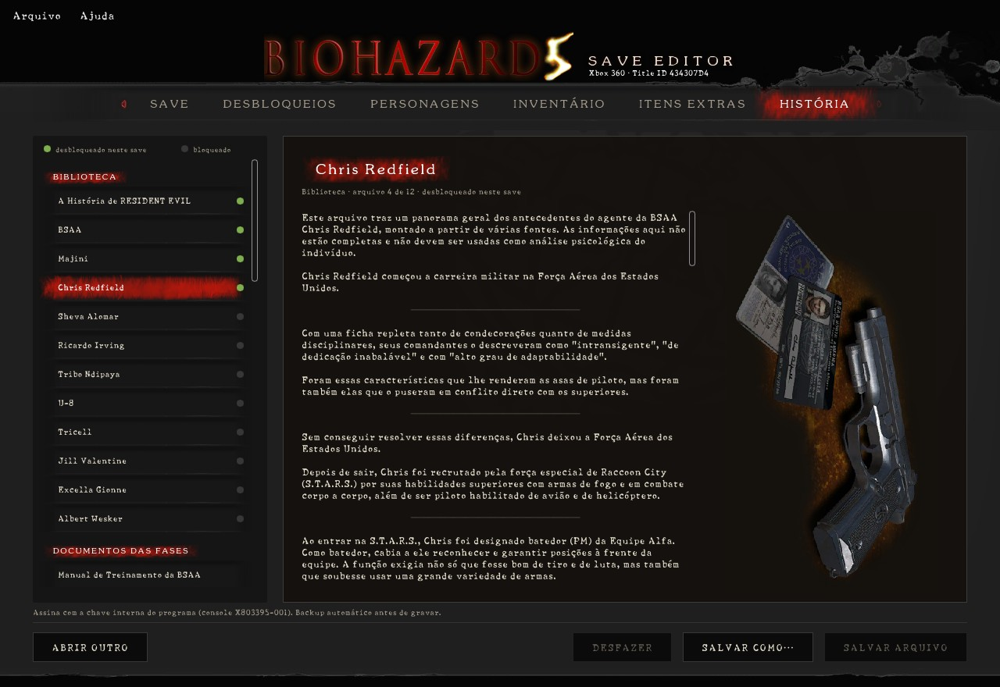 | 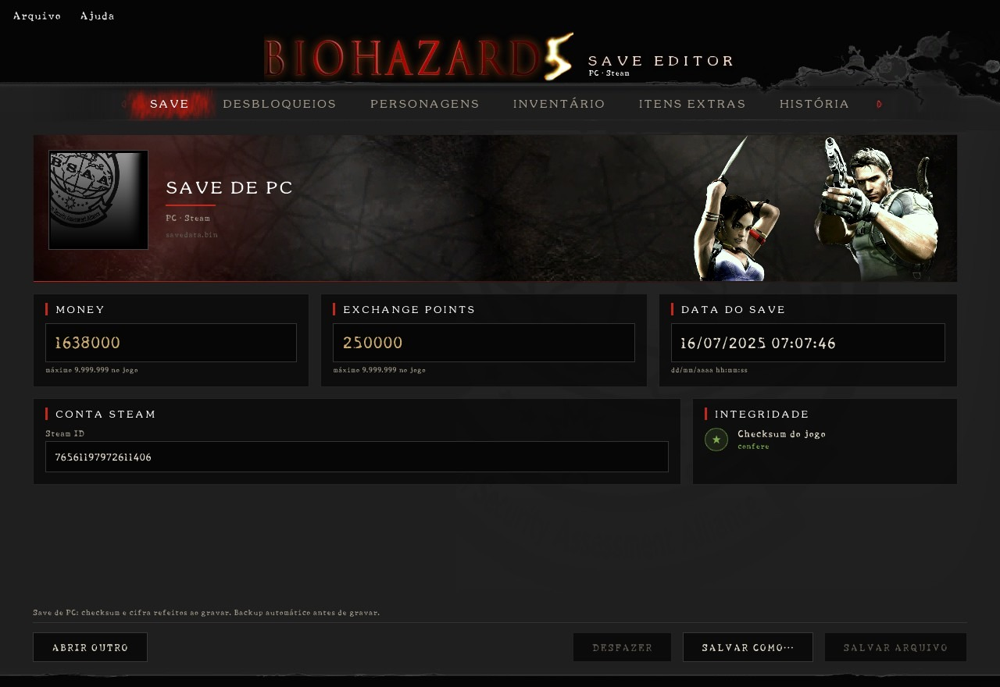 |

As capturas da aba Save usam um save de exemplo com perfil e IDs fictícios.

---

## Download

Baixe a versão mais recente na página de
[**Releases**](https://github.com/lux-insider/biohazard5-save-editor/releases/latest).

| Arquivo | Sistema |
|---|---|
| `BIOHAZARD5-SAVE-EDITOR-<versão>-windows-x86_64.zip` | Windows 10 e 11 (64 bits) |
| `BIOHAZARD5-SAVE-EDITOR-<versão>-linux-x86_64.tar.gz` | Linux x86_64 |
| `SHA256SUMS.txt` | hashes para conferir os downloads |

Descompacte a pasta inteira. Não é preciso instalar nada; no Windows, o
programa não depende do Visual C++ Redistributable.

```
BIOHAZARD 5 SAVE EDITOR/
├── BIOHAZARD 5 SAVE EDITOR.exe   (Linux: biohazard5-save-editor)
├── LEIA-ME.txt                   guia rápido
├── LICENSE
├── console/                      lugar opcional do kv.bin do seu console
└── backups/                      cópia do save antes de cada gravação
```

---

## Como usar

1. **Faça backup do save.** No Xbox 360, copie a pasta `Content` inteira do
   pendrive ou do HD.
2. Abra o programa e clique em **Escolher arquivo**, ou arraste o save para a
   janela:
   - **Xbox 360:** `Content\<perfil>\434307D4\00000001\savedata.bin`
   - **PC (Steam):** `Steam\userdata\<conta>\21690\remote\savedata.bin`
     (no Linux, `~/.steam/steam/userdata/<conta>/21690/remote/`). O diálogo já
     abre nessa pasta quando a Steam está instalada.
3. Faça as alterações e clique em **Salvar arquivo** ou **Salvar como…**.
4. No Xbox 360, devolva o save para a **mesma pasta**. Se você trocou o perfil
   (XUID), use a pasta do perfil novo, mostrada na aba Save.

A plataforma do save é detectada sozinha.

---

## Assinatura do save do Xbox 360

O save do Xbox 360 é um pacote assinado. O editor sempre grava o pacote
assinado e pronto para o console, escolhendo a chave nesta ordem:

1. `console/kv.bin` ao lado do programa (o keyvault do seu console);
2. o keyvault embutido, numa compilação pessoal GOLD (ver
   [Compilação](#versão-gold-uso-pessoal));
3. a **chave interna** do programa, sempre disponível.

O `kv.bin` é **opcional**. Ele é a identidade do seu console: não
compartilhe. Para tirá-lo da cópia da NAND, veja
[docs/EXTRAIR-KV.md](docs/EXTRAIR-KV.md).

---

## Segurança e integridade

- **Gravação segura:** o save é gravado numa cópia temporária, lido de volta e
  conferido; só então substitui o original. Se algo falhar, o original fica
  intacto.
- **Backup automático** do arquivo anterior na pasta `backups/` antes de cada
  gravação.
- **Conferência completa** depois de gravar: checksum do jogo, hashes SHA-1 do
  pacote e assinatura.
- **Validação na abertura:** só aceita saves do Resident Evil 5 (Title ID
  `434307D4`) em pacotes CON; outros arquivos recebem uma mensagem clara.
- **Edições restritas ao que o jogo aceita:** cada slot oferece só itens
  válidos; itens que travam o jogo (chaves das fases) não são oferecidos, e o
  conteúdo de DLC é só para consulta.
- **Privacidade:** o perfil do Xbox é apenas lido; o editor guarda somente a
  gamertag associada ao XUID.
- **Compilação endurecida:** nenhum `unsafe` no código do editor, checagem de
  estouro de inteiros, RELRO completo no Linux e Control Flow Guard no
  Windows.

---

## Compilação

Requisitos: [Rust](https://rustup.rs) estável.

```bash
cargo build --release                                            # Linux
cargo xwin build --release --target x86_64-pc-windows-msvc       # Windows
cargo test --release                                             # testes
```

No Linux, instale as bibliotecas de diálogo, fontes e teclado:

```bash
sudo apt install libgtk-3-dev libfontconfig1-dev libxkbcommon-dev
```

Para gerar o `.exe` do Windows a partir do Linux:

```bash
sudo apt install clang lld llvm
rustup target add x86_64-pc-windows-msvc
cargo install --locked cargo-xwin
```

### extrair-kv

Ferramenta de linha de comando, no mesmo repositório, que tira o `kv.bin` da
cópia da NAND:

```bash
cargo build --release -p extrair-kv                                      # Linux
cargo xwin build --release -p extrair-kv --target x86_64-pc-windows-msvc # Windows
cargo test --release -p extrair-kv
```

### Versão GOLD (uso pessoal)

O `kv.bin` pode ser embutido no executável para que o save saia assinado pelo
seu console sem a pasta `console/`. O título passa a ser
**BIOHAZARD 5 SAVE EDITOR GOLD**.

```bash
RE5_KV_EMBUTIDO=~/kv-temp/kv.bin cargo build --release --features kv-embutido --target-dir target-pessoal
```

Um executável GOLD contém a identidade do seu console: **nunca o
compartilhe**. Depois de compilar, apague `target-pessoal` e a cópia solta
do `kv.bin`. O `.gitignore` já mantém `target-*`, `console/` e `*.bin` fora do
repositório.

---

## Estrutura do projeto

```
src/
├── save.rs           leitura e gravação do save (Xbox 360 e PC): checksum, STFS e assinatura
├── perfil.rs         gamertag lida do pacote de perfil do Xbox
├── itens.rs          catálogo dos 407 registros de item (src/dados/itens.json)
├── historia.rs       textos e ilustrações da aba História (src/dados/historia.json)
├── sistema/          pastas, chaves de assinatura e diálogos de arquivo
└── interface/        controlador: único ponto de contato entre a interface e o backend
ui/
├── app.slint         janela, menus e abas
├── ponte.slint       propriedades e callbacks expostos à interface
├── telas/            uma tela por aba
├── componentes/      botões, campos, listas, slots, ícones e diálogos
├── imagens/          artes, ícones e peças de menu extraídas do jogo
└── fontes/           fontes do jogo convertidas (BH5 Maquina e BH5 Serifa)
dados/                banco completo dos 407 registros de item
ferramentas/          extrair-kv, gerador de fontes, título e scripts de conferência
examples/verifica.rs  leitura e edição de saves pela linha de comando, para testes
docs/                 documentação técnica e capturas de tela
```

---

## Testes e validação

- **46 testes automáticos** (`cargo test --release`), cobrindo checksum das
  duas plataformas, hashes e assinatura do pacote, recusa de arquivos
  inválidos, gravação segura, catálogo de itens e textos.
- **Validado no console:** saves editados e reassinados carregam normalmente
  no Xbox 360, com os itens no jogo.
- **Validado no PC:** num save real da Steam, os valores editados aparecem no
  jogo, e gravar sem alterações devolve o arquivo idêntico byte a byte.

Os detalhes de cada versão estão no [CHANGELOG](CHANGELOG.md).

---

## Documentação

| Documento | Conteúdo |
|---|---|
| [CHANGELOG.md](CHANGELOG.md) | histórico de versões |
| [docs/FORMATO-DO-SAVE.md](docs/FORMATO-DO-SAVE.md) | formato do save: endereços, checksum, pacote CON e assinatura |
| [docs/EXTRAIR-KV.md](docs/EXTRAIR-KV.md) | como tirar o `kv.bin` da cópia da NAND |
| [docs/MIGRACAO-SLINT.md](docs/MIGRACAO-SLINT.md) | arquitetura da interface em Slint |

---

## Contribuir

Erros e ideias são bem-vindos nas [issues](https://github.com/lux-insider/biohazard5-save-editor/issues/new/choose),
com um modelo para cada caso. Para enviar código, veja o
[CONTRIBUTING.md](CONTRIBUTING.md); para falhas de segurança, o
[SECURITY.md](SECURITY.md).

---

## Licença

Código sob a licença [MIT](LICENSE).

A interface usa o [Slint](https://slint.dev) sob a Slint Royalty-free License;
o selo *Made with Slint* aparece na janela "Sobre", como a licença exige.

*Resident Evil 5* / *BIOHAZARD 5* © CAPCOM CO., LTD. As imagens, texturas,
fontes, ícones e textos do jogo pertencem à Capcom. Projeto de fã, gratuito e
sem fins lucrativos, sem ligação com a Capcom ou a Microsoft.

[](https://slint.dev)
